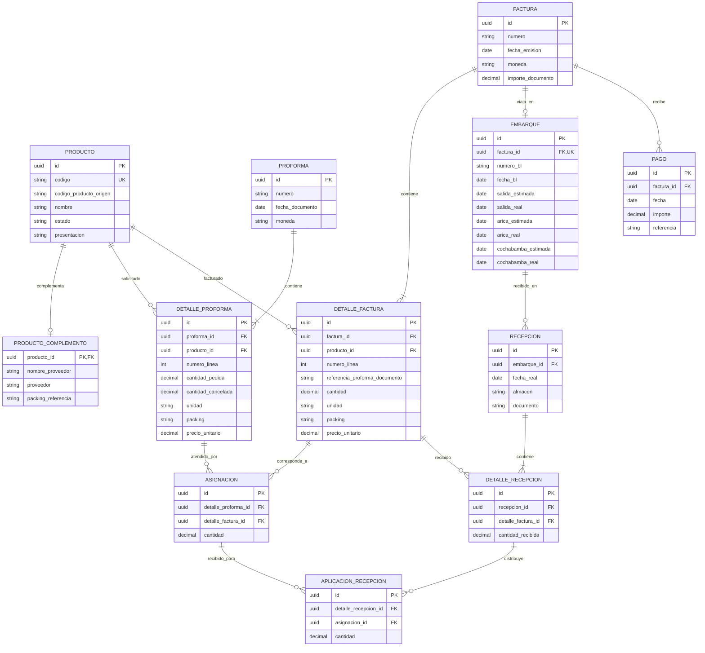

# Modelo de datos acordado

Modelo conceptual del control trabajado en Excel. No es una migración de base de datos. Las entidades permiten conservar cada documento como fue emitido y conciliar sus diferencias sin modificar la proforma original.

## Lectura del modelo

- Una proforma puede atenderse mediante varias facturas. Una factura puede atender varias proformas; la relación está en sus líneas, mediante ASIGNACION.
- Una factura corresponde a un BL. El embarque puede quedar pendiente de completar al registrar la factura, por eso la relación permite temporalmente cero embarques.
- Cada línea mantiene cantidad, unidad, packing y precio propios del documento. El packing del catálogo es solo una referencia.
- La referencia de proforma escrita por el proveedor se conserva aunque todavía no se pueda vincular a una proforma registrada.
- La recepción registra lo que llegó físicamente. Su aplicación a las asignaciones permite determinar qué proforma se recibió. Se admite registrar una recepción cuya conciliación esté pendiente, sin inventar una proforma de destino.
- DETALLE_RECEPCION y APLICACION_RECEPCION expresan en forma explícita el registro de recepción y su vínculo con la asignación ya previsto en el control. No representan nuevos pasos de aprobación para el usuario.
- El forecast se obtiene de estas relaciones; no se guarda como una tabla de totales que deba actualizarse manualmente.

## Identidad, archivos e historial

El código comercial se conserva como texto para no perder ceros iniciales. La clave de producto de la base de origen se conserva por separado y deberá validarse al importar. Las claves internas del nuevo sistema no sustituyen esos códigos comerciales.

El catálogo de la hoja PRODUCTO conectada a la base es la fuente principal. Los campos complementarios proceden de tProductos. Los productos históricos ausentes del catálogo actual deben mantenerse identificados para no perder sus movimientos.

Los PDFs se asociarán a proformas, facturas y pagos mediante registros de adjuntos y almacenamiento privado. Las modificaciones de documentos, fechas, asignaciones y recepciones deben registrar usuario, fecha y cambio. La implementación concreta de adjuntos, permisos e historial se definirá en las migraciones; no está desplegada.
